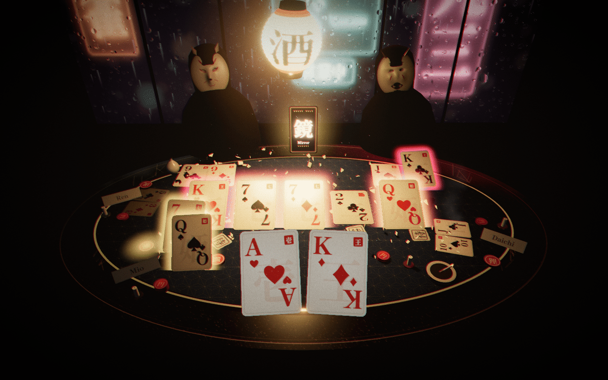
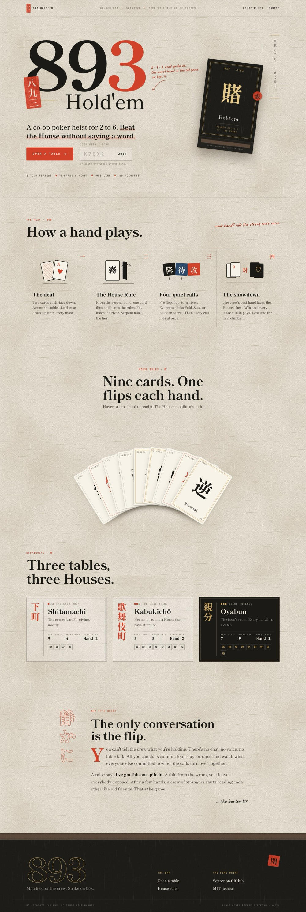
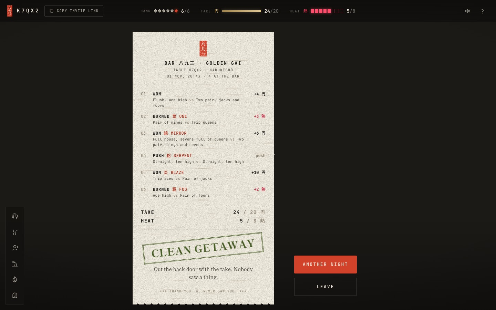

<div align="center">



# 893 Hold'em

**A co-op poker heist for 2 to 6. Beat the House without saying a word.**

One link, no accounts. Open a table, send the link, and sit down at Bar 893, up a
staircase too narrow for two in Shinjuku's Golden Gai. It's 3 a.m. It's raining.

`co-op` · `poker` · `multiplayer` · `browser game` · `rust` · `webassembly` · `three.js` · `cloudflare durable objects`

</div>

---

> **8 · 9 · 3**, read *ya-ku-za*: the worst hand in oicho-kabu, eight plus nine plus three,
> twenty, which scores zero. The gangs took the name for themselves.
> Everybody at this table starts with a bad hand. The point is to play it together.

## How a night plays

Your crew sits on one side of the table. The House sits across, one mask for every two of you.

1. **The deal.** Two cards each, face down. Five on the board, turned over street by street.
2. **The House Rule.** From the second hand, one card flips and bends the hand: Fog hides the river, Mirror shows a mask's card, Bond shares every raise, Reversal makes the weakest hand win. Nine in all. Rumour says there's a tenth.
3. **Four quiet calls.** Pre-flop, flop, turn, river. Everyone still in picks **Fold 降**, **Stay 待**, or **Raise 攻** in secret, and every call flips at once. That flip is the only conversation you get.
4. **The showdown.** Two counts, settled together:
   - **Take 円.** The crew's best hand faces the House's best. Win, and *every* stake still in gets paid, even the trash riding along.
   - **Heat 熱.** Each mask watches two seats. Lose to the mask watching you and you draw heat, even when the crew wins. You were seen.

Six hands a night. Reach the take target and you get away clean. Hit the heat limit and the bar gets raided.

A raise says *I'm carrying this one*. Riding it turns your heat into the crew's take. Whether that's a good trade depends on the night, and you can't talk about it.

## The bar

The story, the Master behind the counter, the masks, the regulars, the stamps, and the
spoilers live in [`docs/STORY.md`](docs/STORY.md). The rules and the art direction live in
[`docs/DESIGN.md`](docs/DESIGN.md).

<table>
<tr>
<td></td>
<td></td>
</tr>
</table>

## Architecture

```
                         ┌──────────────────────────────────────────────┐
  browser                │  holdem893.pages.dev  (Cloudflare Pages)       │
 ┌──────────────────┐    │                                                │
 │ React 19 HUD     │◀──▶│  static site      functions/room/[code].ts     │
 │ three.js scene   │ ws │                    │ service binding (private)  │
 │ WebAudio synth   │    └────────────────────┼───────────────────────────┘
 │ story + stamps   │                         ▼
 │                  │    ┌──────────────────────────────────────────────┐
 │ practice mode ───┼─┐  │  holdem893-rooms  (Worker)                     │
 └──────────────────┘ │  │  one Durable Object per table                  │
                      │  │  ┌──────────────────────────────────────────┐ │
                      │  │  │ worker/index.ts: sockets, storage, alarms│ │
                      │  │  │          │ JSON in / JSON out              │ │
                      │  │  │          ▼                                 │ │
                      └─▶│  │ hachi-wasm  ◀── crates/engine (Rust)       │ │
                         │  └──────────────────────────────────────────┘ │
                         └──────────────────────────────────────────────┘
```

| Layer | Where | What |
| --- | --- | --- |
| **Rules engine** | `crates/engine` (Rust) | Cards and a seeded RNG, a bit-sliced 7-card evaluator (~25 ns/hand in wasm), Monte Carlo odds, the night state machine, per-seat redaction, the regulars (bots), and room protocol validation. No I/O; the whole table serializes. |
| **Bindings** | `crates/wasm` | `wasm-bindgen` `Table`: JSON strings in, JSON strings out. One package runs in the Worker, the browser, and the tests. |
| **Rooms** | `worker/index.ts` | A thin Durable Object: hibernating WebSockets, SQLite-backed storage after every change, one alarm for call timers, regulars' think time, and the showdown. |
| **Edge** | `functions/room/[code].ts` | A Pages Function that forwards `/room/<code>` to the private Worker over a service binding, so players only ever see the Pages URL. |
| **Client** | `src/client` | React 19 HUD on washi paper, a three.js night scene (lantern, rain, neon, masks), synthesized sound, the story layer, stamps, and easter eggs. |
| **Simulator** | `crates/sim` | Plays thousands of all-regular nights to tune heat limits and take targets per table and crew size. |

Why Rust here: the hand evaluator and the regulars' Monte Carlo run inside a Worker with a
CPU budget per message, the rules have to be identical on the server, in the browser's
practice mode, and in the balancing simulator, and the type system makes "no hidden card ever
reaches the wire" something the tests can prove. Why not Rust everywhere: a TypeScript
Durable Object reloads in a second, the same wasm package is tested in Vitest, and the upload
is a quarter of the size.

### Secrecy

Every message a socket receives is built by `view::view_for`, the only path from hidden state
to the wire. Tests serialize views and assert that no other seat's hole cards, no House card,
and no undealt board card appear in the JSON; the rooms smoke test checks every view two live
clients receive over a whole night.

## Run it

Needs Node 22+, Rust (stable) with the `wasm32-unknown-unknown` target, and `wasm-pack`.

```sh
npm ci
npm run dev                      # builds the wasm engine, then Vite on :5173 + the rooms Worker on :8787
```

| Command | Does |
| --- | --- |
| `npm test` | Vitest: client, story, audio, scene helpers |
| `cargo test --workspace --release` | The engine: rules, views, bots, rooms, evaluator (exhaustive over all 2.6M five-card hands) |
| `cargo test --release -p hachi-engine -- --ignored` | All 133,784,560 seven-card hands |
| `npm run smoke:rooms` | Two WebSocket clients play a whole night against `wrangler dev`, checking every view for leaks |
| `npm run e2e` | Two real browsers play a whole night through the UI |
| `cargo run --release -p hachi-sim` | Rebalance the tables |
| `npm run deploy` | Deploy the rooms Worker and the Pages site |

## License

MIT. Matches for the crew. Strike on box.
