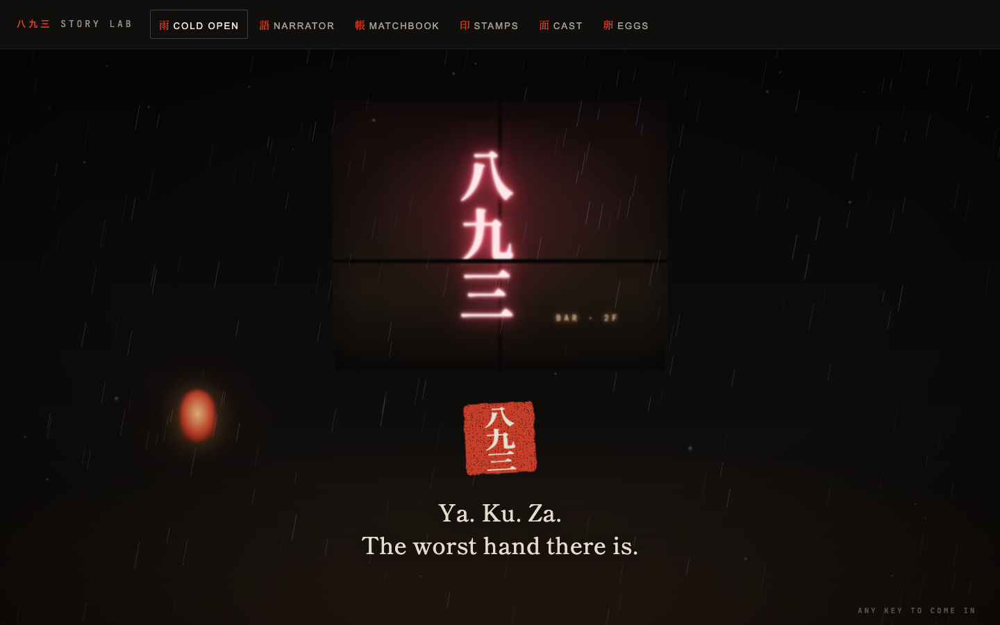
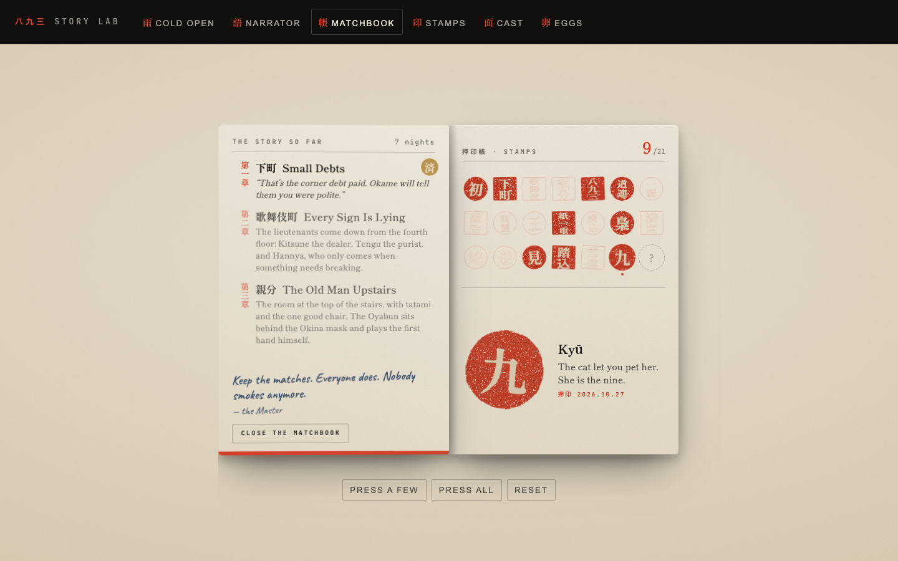

# Bar 893: the story bible

> Eight, nine, three. In oicho-kabu, the old flower-card game, you add your
> cards and keep the last digit. 8 + 9 + 3 = 20, which counts as zero: the
> worst hand there is. Read aloud, it's *ya-ku-za*. Everyone at this bar was
> dealt it. The point is to play it together.

This is the canonical story. `docs/DESIGN.md` owns the rules and the look; this
file owns who is in the room and what they say. The code in
`src/client/story/` answers to it: `lines.ts`, `masks.ts`, and `regulars.ts`
hold every word, and tests keep the voice honest.



---

## 1. The premise

Shinjuku. Golden Gai: two hundred bars the size of closets, stacked along six
alleys, most of them with six stools or fewer. It is three in the morning. It
has been raining since Tuesday.

Up a staircase too narrow for two people is **Bar 893**. No website, no phone,
one paper lantern, a neon sign in the window that hums at 100 Hz.

The crew owes the family. Each of them owes for a different reason: a mortgage
bought out from under them, a brother's gambling, a debt so old nobody
remembers it. The family doesn't take payment by bank transfer. It takes it at
the House's table, across from the masks, one night at a time.

Nobody at the table may speak about their cards. All they can do is commit,
and everybody sees what they committed to. That silence is the whole game.

## 2. The bar

- Six stools at a lacquer table with a gold maki-e rim. The House sits across.
- One paper lantern, older than the Master. It flickers on the hour.
- A window behind the House. Rain on the glass, neon bleeding through.
- A record player with the same record on it for eleven years.
- An umbrella someone left in 1994. He is still holding it for them.
- A ledger under the counter that the cat sleeps on.
- The back door, which the Master puts on the latch when the heat gets close.

## 3. The Master

The bartender. Everyone calls him **the Master** (マスター), the way you do in
Japan when a bar is one man's whole life.

He dealt oicho-kabu for the family for twenty years, then took the bar instead
of a pension. He pours for both sides of the table. He has never been seen
sitting down. He is dry, kind, and tired in the way of someone who has watched
this game too many times to pretend it's fair.

His real name is on the liquor licence, which nobody reads: **八久保 三郎,
Hachikubo Saburō**. *Hachi* is eight. *Ku* is nine. *Sabu* is three.

**How he talks.** Short sentences. Present tense. Never an exclamation point.
Never explains the joke. Notices small physical things (the ice machine, the
yakitori man's fan, a patrol car's engine) instead of naming feelings. Kind
without saying so.

> "Mind the stairs. Sit anywhere. The House sits across."
> "That's the debt. Everything after this is yours."
> "One more and they come up the stairs."

On screen he's set in Shippori Mincho, the narrator's voice, with a vermilion
seal: 主.

## 4. Kyū, the cat

A black cat with one white sock. Sleeps on the ledger. Has used at least four
of her lives. Her name is **Kyū**, 九, nine.

The Master is the eight and the three. The cat is the nine. Together the bar
is 8-9-3. He'll tell you this once, if you pet her, and then never again.

She is on the bar on any night with a 9 in the date, and at about one table in
six on other nights. (A bar night runs to 6 a.m.)

## 5. The House and its masks

The House plays one hand per mask. Which mask holds which hand is fixed per
table, so the 3D scene, the narrator, and the players always agree on who
just took the money. `maskFor(table, index, rule)` in `masks.ts` is the source
of truth; palettes there are hints for the lacquer.

The House speaking as an institution (rarely) is set in mono capitals, a
printed notice, sealed 胴元: *dōmoto*, the bank in Japanese gambling.

### Shitamachi (下町): the collectors

| Seat | Mask | What it is | Who wears it |
| --- | --- | --- | --- |
| 1 | **Okame** 阿亀 | The round-cheeked festival woman, always smiling | The collector. Brings mikan for the regulars, remembers their children's names. The smile is painted on, and so is everything else. |
| 2 | **Hyottoko** 火男 | The fire-blower, mouth puckered at the coals | The kid. Three weeks in the family and still sweating through his shirt. Counts cards out loud when he thinks nobody can hear. |
| 3 | **Ebisu** 恵比寿 | The laughing god of fishermen and luck | The bookkeeper. Writes every debt in a ledger older than the bar. The laugh never reaches the ledger. |

> Okame: "Oh, don't look like that. It's only money."
> Hyottoko: "That's mine? That's mine."
> Ebisu: "Ink is ink. I'll write it either way."

### Kabukichō (歌舞伎町): the lieutenants

| Seat | Mask | What it is | Who wears it |
| --- | --- | --- | --- |
| 1 | **Kitsune** 狐 | The white fox, red at the eyes | The dealer. Runs three card rooms and has never been caught. Very polite, very fond of you. Means neither. |
| 2 | **Tengu** 天狗 | The long-nosed, red-faced mountain goblin | The purist. Thinks he's the best player in Kabukichō and may be right. Contempt for luck. |
| 3 | **Hannya** 般若 | The horned demoness of noh, gold eyes | The enforcer. Rarely speaks. Arrives when something has to be broken, and is always on time. |

> Kitsune: "You looked so sure."
> Tengu, winning: "Skill." Losing: "Luck."
> Hannya: "Sit up straight."

### Oyabun (親分): the old man upstairs

| Seat | Mask | Who wears it |
| --- | --- | --- |
| 1 | **Okina** 翁, the sacred old man of noh | **The Oyabun himself.** Soft-spoken, grandfatherly, and the reason the whole street is quiet after midnight. He plays the first hand of the night himself. He always has. |
| 2 | **Hannya** 般若 | At his left. |
| 3 | **Kitsune** 狐 | At his right. |

> "Sit, children. Sit. The rain will keep."
> "Don't be sad. Debts are only promises."
> "Ah. Good. I like to be surprised."

### The Oni (鬼), at any table

When the Oni card turns, the House sits one extra hand, and the extra stool
goes to the **Oni**: a friend of the family. Nobody invited him. Nobody ever
asks him to leave. He laughs like a truck in the alley.

> "Room for one more?" … "Ha." … "Next time I bring friends."

## 6. The regulars

The bots who fill empty stools are regulars at Bar 893. Each owes the family
for a reason of their own. They speak in Caveat, their own hand, with a round
outlined seal. They introduce themselves when they sit down, and some of them
have a word at exactly one kind of moment.

| Regular | Seal | Story | Sits down with | Their moment |
| --- | --- | --- | --- | --- |
| **Tetsu** | 鉄 | Ironworker. Built half the overpasses in Shinjuku. Lost two fingers and none of his patience. | "Tetsu. I'll sit." | |
| **Okami** | 女将 | Ran an inn at Atami until the family bought the mortgage. Still bows to everyone, including the masks. | "Okami. Please, take the good stool. I insist." | |
| **Hana** | 花 | Florist by the east exit. Always smells of chrysanthemums, which are for funerals. | "Hana. I brought flowers. Not for anyone. Yet." | |
| **Gin** | 銀 | Pachinko professional for forty years. Counts everything twice. | "Gin. I counted the exits on the way up. Two." | The take reaches the target: "Counted. That's enough." |
| **Kuro** | 黒 | Session drummer at a jazz kissa. Sunglasses indoors. | "Kuro. Don't mind the tapping." | |
| **Sumi** | 墨 | Calligrapher. Carves hanko, some for people who don't exist. | "Sumi. If anyone needs a seal, I didn't make it." | 8-9-3: "I carved that seal once. For a man who isn't alive." |
| **Rin** | 鈴 | Night nurse in Ōkubo. Has seen everything twice and been surprised once. | "Rin. I'm on at six. Let's be done by six." | |
| **Jun** | 純 | Second-year student paying off his older brother's debt. Too young for this room. | "Jun. I'm older than I look. A little." | |
| **Mame** | 豆 | Runs the oden cart at the bottom of the stairs. Nobody knows why she owes. Possibly she doesn't. | "Mame. Don't let me win too much. It makes them nervous." | Everyone walks: "Even the ghosts here owe money." |
| **Taka** | 鷹 | Twenty years a detective. Left for a reason he won't name. Hears a raid before it starts. | "Taka. Relax. I'm not on anyone's side anymore." | Heat at ¾ or one away: "I know that engine. Unmarked. Two blocks." |
| **Nao** | 直 | Night taxi driver. Leaves the meter running downstairs, on principle. | "Nao. Meter's running. Let's go." | The last hand: "Meter's at eleven thousand. Just saying." |
| **Fuji** | 藤 | Enka singer. One hit in 1989. | "Fuji. You might know my song. You don't." | |

When a regular's hand carries the crew, sometimes they say so ("Steel." "On the
one." "Encore."). Otherwise they keep quiet.

## 7. The chapters

The three tables are three chapters of one debt, with stakes rising. Each
opens with the Master and the lead mask, and ends with one of three epilogues.
Clearing a chapter (any clean getaway at that table) unlocks its first clean
epilogue in the matchbook. It never gates play: any table is open from the
first night.

### 第一章 · 下町 · Small Debts

The corner table, the low end of the debt. The family sends its collectors.

**Intro** (one of): "The corner table tonight. The collectors. They smile a
lot. Don't smile back." / "Shitamachi. Low ceiling, low stakes, low men. Keep
your heads down." / "The first debt is the small one. They send their smallest
masks for it."

| Ending | The Master |
| --- | --- |
| **Clean getaway** | "That's the corner debt paid. Okame will tell them you were polite." "Kabukichō will want to meet you now. That isn't a compliment." *or* "Ebisu crossed you out. In ink." "Go home. Next time the masks are taller." |
| **Raid** | "Sirens on the stairs. Out the back, past the bins. You know the way now." "The corner table will still be here. So will the debt." *or* "Hyottoko ran first. I'll give him that." "Tomorrow, then. Quieter." |
| **Came up short** | "Close isn't money. Okame smiled the whole way down the stairs." "Come back tomorrow. It'll be raining." *or* "Ebisu wrote it in pencil. That's mercy, for him." "The debt keeps. Debts always keep." |

### 第二章 · 歌舞伎町 · Every Sign Is Lying

The lieutenants come down from the fourth floor. They never come down.

**Intro** (one of): "Kabukichō. Every sign out there is lying to you, in
neon." / "The lieutenants came down from the fourth floor for this. They never
come down." / "The fox is dealing tonight. Count your cards. Then count them
again."

| Ending | The Master |
| --- | --- |
| **Clean getaway** | "You walked out of Kabukichō with money. People don't, usually." "There's a car downstairs. The boss wants a word. Not tonight." *or* "The Tengu said 'luck' all the way to the door." "Upstairs has heard your names now. Sleep with the light on." |
| **Raid** | "Blue light through the rain. The Tengu was out the window before the first knock." "Nobody's surprised. That's the worst part." *or* "Hannya didn't run. She just left. There's a difference." "Lie low. The neon stays on without you." |
| **Came up short** | "The fox counted twice and smiled once. You owe what you owed." "The neon doesn't care. It stays on." *or* "Kitsune bowed, briefly. That means you'll be back." "Rest. Kabukichō never does." |

### 第三章 · 親分 · The Old Man Upstairs

The room at the top of the stairs, with tatami and the one good chair. Every
hand in this room has a catch.

**Intro** (one of): "Top of the stairs. The room with the tatami and the one
good chair. He's already sitting." / "The Oyabun plays the first hand himself.
He always has." / "Shoes off. Voices down. Every hand in this room has a catch."

| Ending | The Master |
| --- | --- |
| **Clean getaway** | "He bowed. I've poured for him for thirty years. He has never bowed." "The debt is paid. Go home. Come back only if you want to." *or* "He laughed. Once, softly, like a door closing." "You're free. That has never meant what people think." |
| **Raid** | "Even the boss's room gets raided. He finished his tea first." "He'll forgive the police. He won't forget you." *or* "Hannya held the door for him. Nobody held it for you." "Rest. He doesn't hurry. Neither should you." |
| **Came up short** | "He said nothing. He poured you a drink himself. That's worse." "Same time tomorrow. The rain will keep." *or* "'Patience,' he said. He has more of it than you have nights." "Come back when you're ready. He'll be sitting." |

A clean night can earn one more line: a **clean sweep** (six for six: "I've
seen it once before. He doesn't drink here anymore.") or a **close call**
(heat one from the limit: "That close. I had the back door open.").

## 8. What the narrator listens for

`narrate(prev, next, you)` turns one change in the game view into at most three
lines, and usually none. Silence is the default; a line has to earn its place.

| Moment | When | Who speaks |
| --- | --- | --- |
| Welcome | First view of a room | The Master: first visit, returning, rejoining mid-night, or spectating. Special greetings win: a name like "Oyabun", a room code with 893 in it, real 3 a.m. |
| Someone sits down | A new seat in the lobby | A regular introduces themselves; a human is named by the Master. One line, however many sit. |
| The night starts | Lobby to hand 1 | The Master's chapter intro, then the lead mask (Okame, Kitsune, or the Okina). |
| A new hand | Hand 2 onward | The House Rule speaks for the hand. The **last hand** always gets its own line: what you still need, or that the debt's covered, or that the street is listening. |
| The House Rule | A rule card turns | A line beyond the card's own flavour. Under **Fox** the Master names whose cards are face up. Under **Oni** the Oni introduces himself. |
| The showdown | A hand resolves | One reading, most special first (below). Ordinary results go to the Master, the mask across the table, or a regular who carried it. |
| The take | It reaches the target | "That's the debt. Everything after this is yours." (or Gin) |
| The heat | Crossing ½, ¾, one from the limit | The Master noticing the street (or Taka, from ¾). Never on top of a raid. |
| The verdict | The night ends | The chapter epilogue, plus a coda for a sweep or a close call. |
| Idle | A slow timer in the lobby | `idleLine(view, tick)`: about two ticks in three say something small. |

**Showdown readings, most special first:** a royal flush (either side), 8-9-3
in the champion's cards and the board, a bad beat (full house or better and
still lost), the Serpent's tie, a Reversal win, the quiet champion (never
raised, no pair, nothing above a jack, and carried it anyway), a rider with
nothing but a high card who got paid, players who were **seen** (lost to the
House on a hand the crew won, and drew heat for it), then plain crew, House,
tie, or walked.

**Sameness at the table.** Every line is chosen by `pick(bank, code, hand,
event)`: an FNV-1a hash of the room code and the event, walking a fixed shuffle
of the bank by hand number. Every seat sees the same words at the same moment,
and a bank doesn't repeat within a night until it runs out. Only the welcome
is personal.

## 9. Voice rules

1. **No exclamation points.** Anywhere. Tested.
2. **Short sentences.** Rarely more than twelve words. Never more than eighteen. Tested.
3. **Concrete over abstract.** The ice machine, the yakitori man's fan, the meter running. Not "tension rises".
4. **Dry, kind, a little noir.** The Master likes you. He'd never say so.
5. **The House is polite and dangerous.** Masks never threaten. They don't have to.
6. **Restraint over camp.** No "yakuza movie" slang, no fake Japanese, no "-san" on everything. Japanese appears where it would: names, places, kanji on seals.
7. **Silence is a line.** If nothing needs saying, say nothing.
8. **Never generic.** If a line would fit any card game, cut it.
9. Typographic apostrophes and quotes. No emoji.

## 10. The cold open

The first visit plays a short, skippable scene (any key, any tap), then never
again unless asked. An alley in the rain. The window of Bar 893 on the second
floor, 八九三 in neon bleeding through the wet glass. A lantern swaying.

1. "Shinjuku. Golden Gai. Three in the morning."
2. "In the old card game, eight, nine and three add up to nothing."
3. "Ya. Ku. Za. The worst hand there is." *(a seal presses: 八九三)*
4. "Everyone in this bar was dealt it. Come up. Play it together."

---

## 11. Spoilers: stamps and easter eggs



### The matchbook

A vermilion matchbook from a bar with no website: BAR, 八九三, 893, "Golden
Gai, second floor, six stools, no phone". It opens like a book. The inside of
the flap keeps the story so far (nights played, the three chapters, and the
epilogue line for each chapter cleared) and a note from the Master: "Keep the
matches. Everyone does. Nobody smokes anymore." The card inside holds
twenty-one hanko slots, seven by three, and the stamp you point at, large.

It lives in `localStorage` under `893:matchbook`: stamps with the date they
were first pressed, chapters cleared, nights played, whether the cold open has
played, and eggs found.

### The stamps

| | Stamp | Verse | How |
| --- | --- | --- | --- |
| 初 | First Night | Everyone has a first stool. | Play a night to its verdict. |
| 下町 | Small Debts | The corner table, paid in full. | Clean getaway at Shitamachi. |
| 歌舞伎 | Every Sign Is Lying | Out of Kabukichō with money. People don't. | Clean getaway at Kabukichō. |
| 親分 | Oyabun's Favor | He bowed. He has never bowed. | Clean getaway at Oyabun. |
| 八九三 | Ya-ku-za | Eight, nine, three. The worst hand, and it paid. | The crew wins while your hole cards and the board hold an 8, a 9 and a 3, with at least one in your hand. |
| 道連 | Ride or Die | Paid, holding the worst hand at the table. | The crew wins and your hand was the weakest of all. |
| 一騎 | Lone Rider | Everyone else folded. You went anyway, and won. | The only one in, and the crew wins. |
| 総取 | Clean Sweep | Six hands. Six wins. Tell no one. | The crew wins all six. |
| 幽霊 | Ghosts | Every hand on the felt. The street noticed anyway. | Everyone folds. |
| 王 | Royal | Ten to the ace, one suit, our side. | The crew's best is a royal flush. |
| 紙一重 | Close Call | Clean, by the width of a sheet of paper. | Clean getaway with heat one from the limit. |
| 滑込 | Under the Wire | Short until the sixth hand. Then not. | The last hand covers the debt. |
| 梟 | Night Owl | Played at three in the morning. The real one. | Play between 3:00 and 3:59, local time. |
| 満席 | Full House | Six stools, six people, no regulars. | Start a night with six humans. |
| 蛇 | Snakebit | A tie, under the Serpent. A loss with manners. | Lose a tie to the Serpent. |
| 逆 | Upside Down | The worst hand won. The boss smiled. | Win under Reversal. |
| 見 | You Were Seen | They got paid. You got remembered. | Draw heat on a hand the crew won. |
| 踏込 | The Knock | Everyone hears it once. Out the back. | Get raided. |
| 常連 | Regular | Five nights. The stool knows your shape. | Play five nights. |
| 九 | Kyū *(secret)* | The cat let you pet her. She is the nine. | Pet the cat. |
| 豚 | Buta *(secret)* | The card that isn't in the deck. | Find the hidden card. |

### The easter eggs

Each egg is announced as a `893:egg` CustomEvent on `window` (detail
`{ id, line }`) and in the `useEggs` store, so the neon sign, the lantern, and
the narrator can react without importing each other.

| Egg | How | What happens |
| --- | --- | --- |
| `neon` | Type **8 9 3** anywhere outside a text field | The neon stutters. "Eight, nine, three. The sign heard you." |
| `konami` | ↑ ↑ ↓ ↓ ← → ← → B A | The card that isn't in the deck slides out: **豚 Buta, Pig.** "Eight, nine, three: twenty, which counts as zero. Nothing changes this hand." The House has never drawn it. It keeps it in the deck anyway. Stamps *Buta*. |
| `kanpai` | Type **kanpai** | A clink. "Kanpai. To bad hands." |
| `lantern` | Click the lantern eight times in four seconds | It gutters. "Leave the lantern. It's older than me." |
| `code-893` | A room code with 8, 9, 3 in a row (the code alphabet has all three) | "Table eight-nine-three. Somebody upstairs is laughing." |
| `oyabun` | Call yourself Oyabun, 親分, Boss, or Kumichō | "You wrote 'Oyabun' on the board. He's going to see that." |
| `master` | Call yourself Master or Hachikubo | "There's only one Master in here." |
| `cat-name` | Call yourself Kyū | "That's the cat's name. She'll allow it, this once." |
| `three-am` | Open the bar between 3:00 and 3:59 | "It really is three. Even I'm usually closing by now." |
| `cat` | On her nights, Kyū is on the bar. Pet her. | She closes her eyes. ごろごろ. Stamps *Kyū*. "She's the nine. I'm the eight and the three." |
| `console` | Open the developer console | A hanko in box-drawing characters, and the way to the source (MIT): https://github.com/KarthikSubramanian07/893-Hold-em |

Things only a careful reader finds: the Master's name is 8-9-3; the cat makes
it whole; the matchbook holds 21 stamps, and 21 is what eight, nine, three and
one more card make in oicho-kabu, which is one; the hidden card is numbered 零,
zero.

## 12. For integrators

```ts
import { narrate, Narrator, ColdOpen, shouldPlayColdOpen, Matchbook, StampToast,
         useMatchbook, installEggs, checkName, checkCode, catVisits, BarCat,
         maskFor } from './client/story';

// On every new view:
const lines = narrate(prev, next, you, { returning: useMatchbook.getState().data.nights > 0 });
useMatchbook.getState().observe(prev, next, you); // presses stamps, queues toasts

// Once at startup:
useEffect(() => installEggs(), []);
```

- `<Narrator lines={lines} tone="night" />` fills whatever box it's given. Pass
  every line array; ids already shown are ignored.
- `<StampToast />` reads the matchbook's queue. Position it with a class.
- `<ColdOpen onDone />` when `shouldPlayColdOpen()`.
- `maskFor(table, houseIndex, rule, houseCount)` picks the mask and palette for
  each House hand in the scene.
- Call `checkName(name)` on rename, `checkCode(code)` on join, and
  `lanternClick()` from the lantern. Render `<BarCat />` when
  `catVisits(code)`.
- Preview everything at `/src/client/story/lab.html` under `npm run dev:web`.

### Where it lives in the app

| Piece | Mounted in | Notes |
| --- | --- | --- |
| Narration and stamps | `hud/useTableStory.ts`, used by `pages/Table.tsx` | Every view change runs `narrate` and `observe`. The first view after (re)connecting speaks but never stamps (`witnessed`), so a reload on the receipt can't count a night twice. Lines wait for the shoji doors to open. |
| `<Narrator />` at the table | `pages/Table.tsx` | `subtitleSlot(phase, wide)`: during a hand the line floats at the top of the scene, over the House, never over your cards or the dock. Under the lobby card it gets a reserved strip at the foot of the screen; at the end of the night it sits beside the receipt on a wide screen. |
| Eggs, the hidden card, stamp slips, remarks off the table | `story/StoryLayer.tsx`, lazy-loaded by `app/App.tsx` on every route | Installs the eggs once. On the paper pages the Master's remark comes on a washi slip at the foot of the screen; typing 893 also makes the landing numerals stutter (`:root[data-egg='neon']`). The 3D scene listens to the same `893:egg` events. |
| The cold open | `StoryLayer`, on the landing page only | First visit to `/` only (`coldOpenFor`); `main.tsx` holds the dark until it loads. Invite links go straight to the table. Replay it from the matchbook. |
| The matchbook | `/matchbook` (`pages/MatchbookPage.tsx`) | Linked from the landing nav and footer and from the receipt (`?table=CODE` gives a way back). |
| Kyū | `hud/TopBar.tsx`, on `catVisits(code)` nights | She sleeps on the bar, beside the switches. |

Fonts: the story's extra Shippori slices live in `story/fonts.css`, generated
with the app's subset by `node scripts/fonts.mjs`, and load with the story
layer rather than up front.
