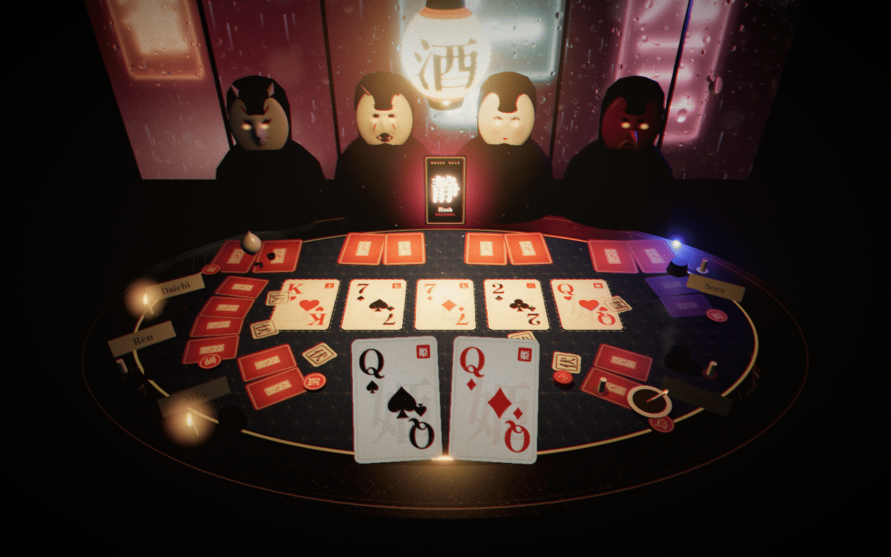

# The night world · `src/client/scene`

> 3 a.m. in a Golden Gai bar, printed as a risograph.



The 3D table for 893 Hold'em: one paper lantern over a black urushi oval,
rain on the window behind the House, neon kanji bleeding through it, and four
masks waiting for you to blink.

```tsx
import { TableScene } from './scene';

<TableScene view={gameView} quality="high" />
```

That is the whole contract. Hand it a `GameView` and it draws the table, full
bleed, and animates whatever changed since the last view. `quality="low"` drops
the post stack for weak devices.

## How it thinks

```
GameView ──► derive.ts ──► SceneTargets ──► components damp toward targets each frame
               (pure)        (plain data)      (MathUtils.damp, dt capped at 0.05)
```

- **Nothing is tweened.** Every visual is a pure function of the view
  (`derive.ts`), and every component eases toward it each frame. Skip a street,
  reconnect mid-hand, swap fixtures at random: it all lands gracefully because
  there is no animation queue to get out of sync.
- **Nothing hits the network.** Fonts are bundled from `@fontsource`. Every 2D
  thing (cards, felt, lacquer, masks, neon, call slips) is painted on a canvas
  at runtime and cached. The environment map is built from `<Lightformer>`s.
  The troika name plates are clamped to Latin‑1 so troika never reaches for a
  CDN fallback font.
- **Shared per-frame values** (heat, neon, police lights, haze, the lantern's
  swaying position) live in one mutable bag (`live.ts`), damped once per frame
  by `<LiveDriver>`.

## Map

| File | What it is |
| --- | --- |
| `index.tsx` | `<TableScene>`: canvas, lights, performance monitor, suspense on fonts |
| `derive.ts` | View → targets: seat order, champions' best five, mask moods, heat → neon / police / haze |
| `layout.ts` | Seat arc, mask row, board slots, camera framing and hero-card size per aspect ratio |
| `cardInfo.ts` | Card labels, kanji flourishes, texture keys, stance kanji (降 待 攻 伏) |
| `live.ts` / `LiveDriver.tsx` | The shared per-frame bag and its damping |
| `CameraRig.tsx` | Aspect framing, slow breathing, pointer parallax, a lean-in as heat climbs |
| `parts/Table.tsx` | Urushi oval, gold maki-e rim, sashiko felt, ashtray, sake set |
| `parts/Lantern.tsx` | The chōchin: ribbed lathe, glowing washi, swaying spot light with soft shadows |
| `parts/Room.tsx` | The rain-on-glass shader, neon signs, mullions, police lights |
| `parts/Masks.tsx` | Kitsune, hannya, okame, tengu: displaced half-spheres with painted faces and glowing eyes |
| `parts/Seats.tsx` | Place cards, avatar seals, stake tokens (and the Hush cup), lock candles, call slips |
| `parts/Card.tsx` | One damped card: deal, flip with a hop, fold into the dark, showdown lift and glow |
| `parts/Board.tsx` · `HeroCards.tsx` · `RuleCard.tsx` | The five, your two (held up to the camera), the House Rule |
| `fx/` | Dust in the lantern cone, cigarette smoke, tie smoke, gold leaf, the post stack |
| `textures/` | Canvas painters for everything above |
| `dev.tsx` | The scene lab (dev only, see below) |

## What the view drives

| View | On the table |
| --- | --- |
| `phase: 'lobby'` | Six chairs; seals and place cards pop in as people join |
| `seats[].cards` | `null` absent, `'back'` face down, a card face up; `null → card` deals from the House |
| `seats[].active = false` | Cards slide back and go dark |
| `seats[].locked` | The seat's candle lights |
| `seats[].calls` | The newest call drops as a stamped washi slip; `'hidden'` stamps 伏 |
| `seats[].stake` | Lacquer tokens drop and clack; `null` (Hush) hides them under a cup |
| `seats[].connected = false` | The seat dims |
| `house[]` | One masked figure per hand, cards in front |
| `rule` | The tall lacquer card spins in from its back |
| `heat / heatLimit` | Neon burns hotter and flickers faster; police lights strobe past half; the camera leans in |
| `phase: 'showdown'` | Champions' best five lift and glow: kin gold for the crew, neon red for the House |
| `result.outcome` | Crew: gold leaf. House: eyes flare, neon surges, heat haze. Tie: smoke. Walked: the lantern dims |
| `verdict` | Clean: gold leaf. Raid: police lights full. Short: a dim lantern |

## Performance

- `quality="high"`: riso misregistration and heat haze, bloom on emissives only
  (threshold 1.0), ACES tone mapping, vignette, grain.
- `<PerformanceMonitor>` drops the pixel ratio to 1 when frames slip, and drops
  the post stack only if it really can't keep up (under 24 fps). The pixel ratio
  is capped at 1.75.
- `prefers-reduced-motion` stills the camera, the lantern sway, and the masks'
  drift, and slows the rain.
- 60 fps at 1440×900 with the full post stack on an M1.

## Scene lab

```sh
npx vite --port 5191
open http://localhost:5191/scene.html?fixture=river
```

`1`–`5` pick a fixture, `P` plays a scripted hand (lobby → deal → flop → turn →
river → showdown), `G` shows the HUD guide bands, `H` hides the buttons.
URL params: `fixture=lobby|preflop|river|showdown|over|crowd`,
`quality=low`, `heat=<n>`, `outcome=crew|house|tie|walked`,
`verdict=clean|raid|short`, `rule=<id>`, `clean` (no buttons), `play`.

`scene.html` is never built; Vite only builds `index.html`.
